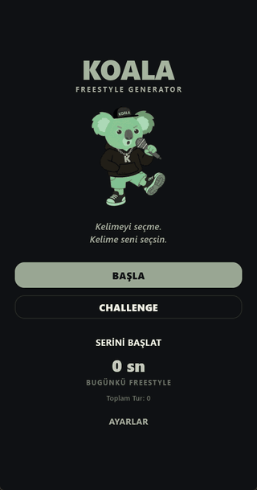
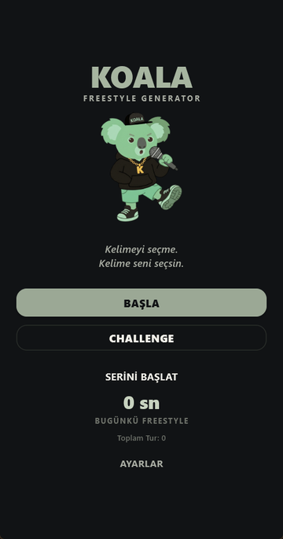
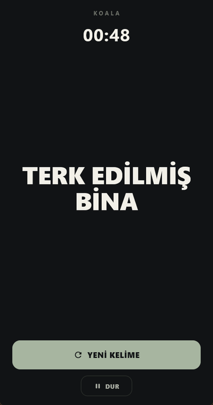
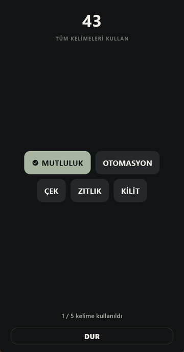
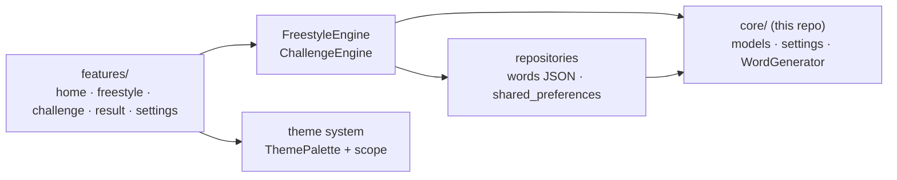

# Koala Freestyle

A Flutter app for practicing Turkish freestyle rap. It throws a random word at you every few seconds and you work it into your verse before the next one lands.

**[Try it in your browser](https://berkste.github.io/koala-freestyle/)** · **[Download the Android APK](https://github.com/Berkste/koala-freestyle/releases/latest)**

<p align="center">
  
</p>

| Home | Single word | Challenge |
|---|---|---|
|  |  |  |

> This is the showcase repository: screenshots, the live demo, the APK and the pure Dart core with its tests. The full app source is kept private.

## Features

- **Freestyle rounds:** a 3-2-1 countdown, then a new word every 3–20 seconds for a 30–180 second round. Pause, resume and skip a word.
- **Word modes:** a single word at a time, or a pair to connect in one line.
- **Challenge mode:** a fixed set of words drawn up front; mark each one as you use it before time runs out.
- **Word bank:** 629 Turkish words and phrases in 16 categories (street, money, battle, technology, humor…) with four difficulty levels. Recently used words are not repeated within a round.
- **Stats:** rounds, challenges, words used, training time, and current and longest daily streak, kept on the device.
- **Six themes:** Koala, Midnight, Fire, Ocean, Forest and Royal, switchable mid-round without losing the round.
- **Haptics** on the countdown and on each new word. Haptics and animations can each be turned off in settings.

## Architecture



- **`FreestyleEngine` and `ChallengeEngine`** hold all round logic: countdown, timer, word rotation, pause/resume, completion. They have no widget dependency and are unit tested directly.
- **Drift-free timing:** elapsed time is always computed from wall-clock differences, never by counting timer ticks, so a round stays accurate even when ticks are delayed or the app is briefly backgrounded.
- **Theme system:** every color comes from a `ThemePalette` exposed through an inherited scope; widgets never switch on the theme type.
- **Repository layer:** words load from a bundled JSON asset; settings, statistics and the theme persist through `shared_preferences`.

## The core package

[`core/`](core/) is the Flutter-free part of the app as a standalone Dart package: the `Word`, `Difficulty`, `WordCategory` and `WordMode` models, session settings and results, user statistics, and the `WordGenerator` that picks words by category and difficulty without repeating recent ones.

```sh
cd core
dart pub get
dart test
```

## Tests

The full app has 29 tests covering the engines (lifecycle, pause/resume, skipping, an empty word pool), the word generator, the statistics repository, theme switching and propagation, and the mascot image fallback. The word generator tests are included here in `core/test/`.

## Tech stack

Flutter 3.47 · Dart 3.13 · `shared_preferences` · fully offline, no backend.

## Known limitations

- **No beat sync.** The BPM option is stored with the session settings, but the app plays no audio and does not time words to a beat yet.
- **No rhyme help.** Words are not grouped or suggested by Turkish rhyme.
- **Word bank size.** 629 entries; long sessions will start to repeat words across rounds.
- **Challenge completion is self-reported.** There is no speech recognition; you tick off each word yourself.
- The app UI is in Turkish.

## License

[MIT](LICENSE). The word bank was compiled for this project.
